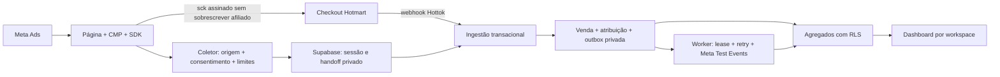

# Pulso Campanhas — tracking first-party e Hotmart

Implementação revisável do P0 da [issue #2](https://github.com/agenciablackmambamarketing-cyber/pulso-/issues/2), incorporando e ampliando o SDK da [PR #1](https://github.com/agenciablackmambamarketing-cyber/pulso-/pull/1). **As alterações estão implantadas somente no staging isolado; produção permanece inalterada. O runtime interno já foi configurado no Vault; credenciais reais de Hotmart/Meta e aceitação externa ainda estão pendentes. Meta opera exclusivamente com Test Events; ativação de conversões de produção não está disponível nesta entrega.**

## Fluxo implementado



- SDK sem dependências, opt-in: `page_view`, `view_content`, `checkout_click`, `checkout_started` somente quando observado. Não inventa início de checkout a partir de clique nem Purchase no navegador.
- Coletor com corpo limitado a 16 KiB por bytes, site/origem exatos, consentimento versionado, schema allowlist, limites atômicos no banco e retomada por token assinado. O navegador não escolhe workspace, sessão de banco ou dataset.
- `sck` opaco com 30 caracteres, HMAC e validade registrada no servidor; UTMs, `src/sck/xcod`, Meta, Google e Taboola permanecem no processamento privado. Parâmetros de afiliado e `sck` existente são preservados; conflito implica ausência de vínculo Pulso, sem atribuição por adivinhação.
- Hottok em digest SHA-256; aprovação, deduplicação, atribuição e outbox na mesma transação. Reembolso/chargeback não são revertidos por aprovação atrasada; transações e moedas preservadas, sem somar moedas diferentes.
- Credencial CAPI por workspace/dataset criptografada AES-256-GCM com AAD; chave somente em Edge secrets. Validação de acesso ao dataset via GET, envio de Purchase somente confirmado e consentido, exclusivamente com `test_event_code`.
- Outbox com lease, fencing, backoff, limite de oito tentativas, reprocessamento condicionado e event_id estável. Resposta `events_received=1` é necessária para marcar aceitação. Aceitação não prova atribuição de anúncio.
- Dashboard com métricas reais e agregadas, saúde, origens conhecidas, diagnósticos CAPI e configuração administrativa. Falhas de consulta aparecem como indisponibilidade. Não busca dados de comprador, matching, IDs de clique, transações ou payloads brutos.

## Banco existente e auditoria

O projeto de produção `nlrhtioxsbncpluchfcz` foi inspecionado **somente em leitura**, incluindo 12 migrações, 21 tabelas com RLS, funções, grants, políticas e fontes de duas Edge Functions. [Auditoria e revisão da PR #1](docs/AUDIT_TRACKING.md).

O SQL legado `20261025_pulso_core.sql` é parcial. **Não execute `supabase db push/reset` contra o projeto existente para sincronizar esta branch. Não reaplique SQL antigo nem simule o histórico das 12 migrações.** O [baseline observado](supabase/baseline/README.md) é apenas para banco novo isolado, não uma migração de produção. As quatro novas migrações são incrementais e precisam de revisão e aplicação ordenada em staging.

## Desenvolvimento e testes

Requer Node >=22, npm e PostgreSQL 17 com pgcrypto. Dependências de teste fixadas em `package-lock.json`; runtime Supabase e tipos fixados em `deno.lock`.

```sh
npm ci --ignore-scripts
npm test
# Somente uma instância descartável local, com permissão de criar bancos:
PULSO_TEST_DATABASE_URL=postgres://postgres@127.0.0.1:55432/postgres npm run test:db
# Deno 2.9.6:
deno task check
```

`test:db` cria um banco temporário aleatório, carrega o baseline, aplica as novas migrações e remove somente esse banco ao terminar. Recusa host fora de loopback e não lê credenciais Supabase. Os stubs locais de Auth permitem testar RLS/RPCs, mas não equivalem a executar o gateway Auth/PostgREST hospedado. O fluxo integrado usa PostgreSQL real e resposta Meta simulada; não comprova recepção externa. [Relatório de verificação](docs/VERIFICATION.md).

## Operação e próximos passos

[Estado atual do staging e configuração pendente](docs/STAGING_STATUS.md).

- [Deploy, configuração e rollback](docs/DEPLOY_TRACKING.md)
- [Consentimento, matriz de dados e retenção](docs/PRIVACY_TRACKING.md)
- [Meta CAPI e contratos](docs/META_CAPI.md)
- [Checklist Inglês de Embarque e E2E de staging](docs/INGLES_DE_EMBARQUE_ACTIVATION.md)
- [SDK e exemplo isolado](tracker/README.md)

Nenhum token deve ser enviado em chat ou commit. Use o formulário administrativo autorizado e o gerenciador de segredos. Google Ads/Taboola mantêm os identificadores e a fronteira de adaptadores; uploads, OAuth, custos e reconciliação dessas plataformas permanecem pendentes.
